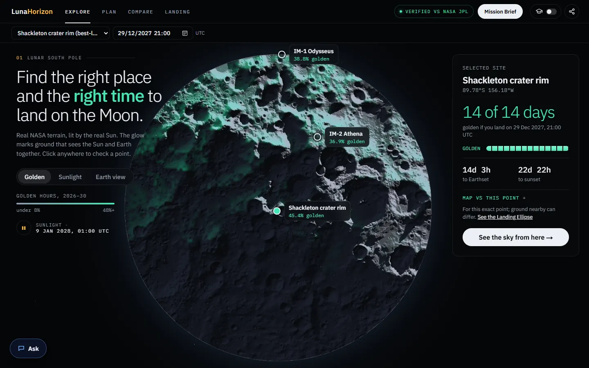
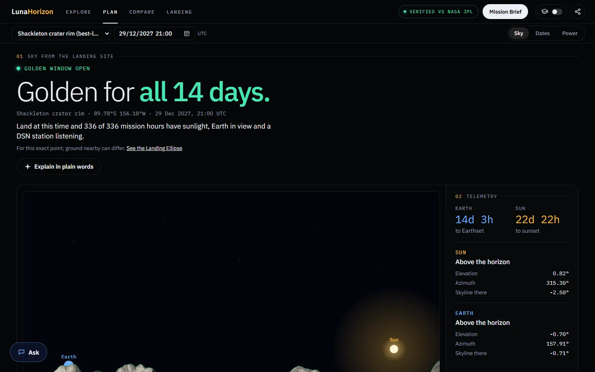
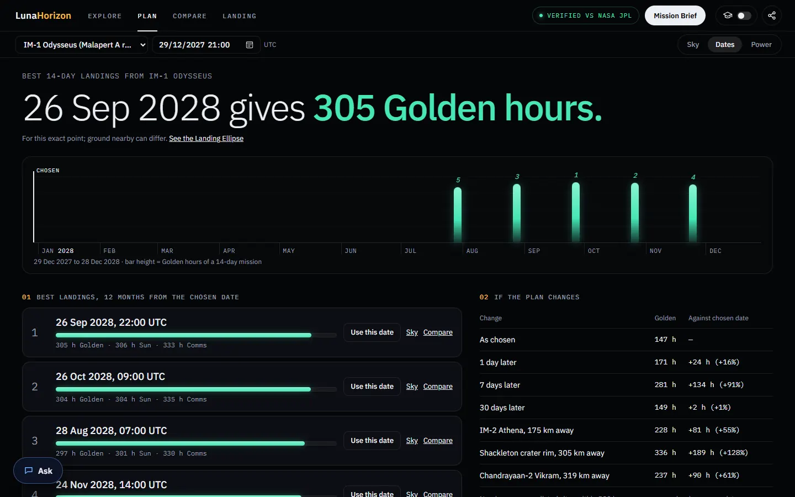
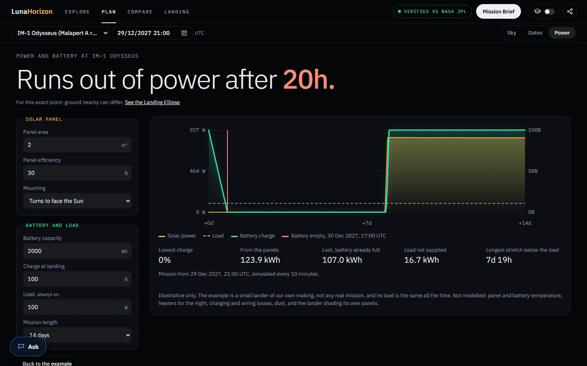
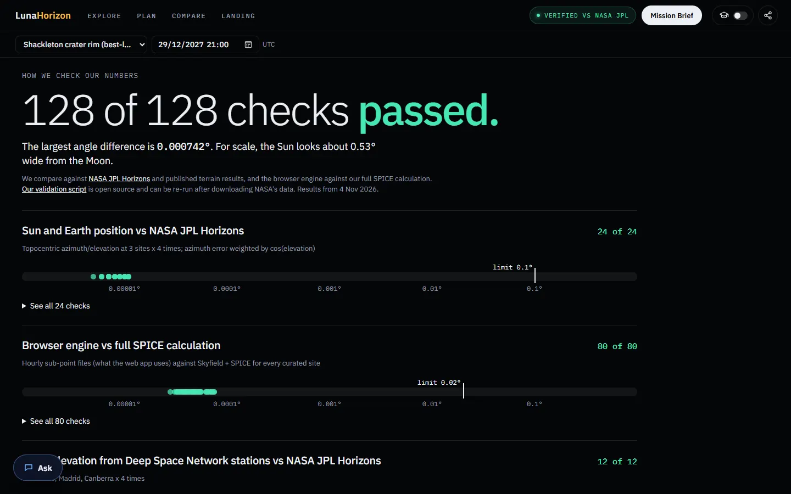
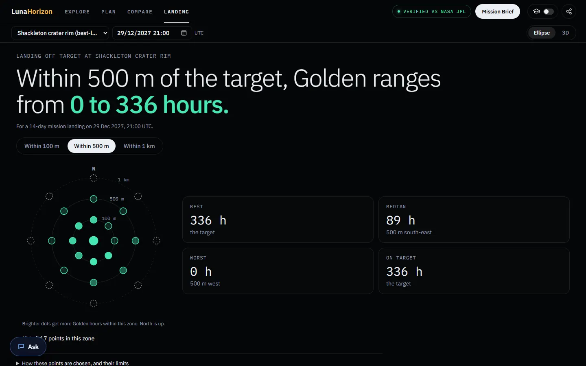
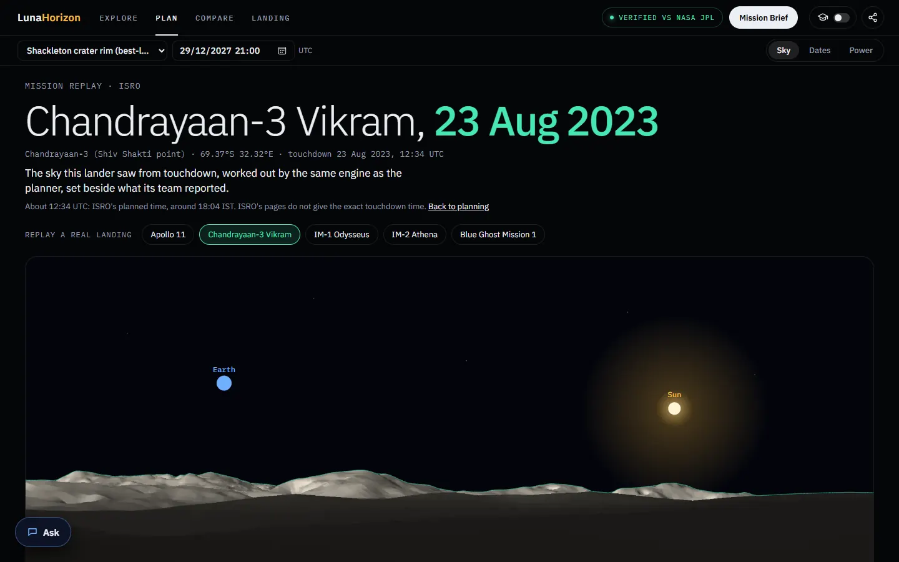

# 🌙 LunaHorizon

> **Find the right place and the right time to land on the Moon.**

🌐 **Live site:** https://lunahorizon.vercel.app

**Team Astral** · Cumilla, Bangladesh
NASA Space Apps Challenge 2026 · Challenge: **Lunar Landing Site Navigator** (formerly listed as *CLPS Lunar Mission Browser*)
Team page: https://www.spaceappschallenge.org/2026/find-a-team/team-astral3/



---

## 🛰️ The problem

At the Moon's south pole the Sun stays a few degrees above or below the horizon, and Earth sinks behind the skyline and rises again. Crater rims and mountains can hide both.

For a lander, this decides everything:

- ☀️ **Power:** no Sun above the skyline means no solar power.
- 🌍 **Contact:** no Earth above the skyline, or no NASA Deep Space Network dish facing the Moon, means no direct link home.

Pick the wrong spot or the wrong day, and a lander can lose both. IM-1 and IM-2 showed how fine the margins are. The tools that compute Sun and Earth positions exist, but they take an expert to read.

## 💡 What LunaHorizon does

Choose a **site** (20 curated landing sites, or any point you type) and a **date**. LunaHorizon then shows the sky from that exact point: when the lander has sunlight, when it can talk to Earth, and the **Golden hours** when it has both.

| Menu | Page | What you get |
|---|---|---|
| **Explore** | Atlas | The south polar map from NASA LOLA terrain, lit from the real Sun's direction across a lunar day. Golden / Sunlight / Earth-view layers, site pins, and a card for any point you click. |
| **Plan** | Sky | The lander's view: Sun and Earth over the real skyline, a 14-day playback, sunset and Earthset countdowns, and a 30-day timeline of Sun, Earth, DSN, Comms and Golden windows. |
| | Dates | The 5 best landings in the next 12 months on a year strip, what a slip of 1, 7 or 30 days or a nearby site would change, and the same landing moved 1–2 km or by a day. |
| | Power | An example lander's solar panel and battery through the mission: does it survive the night? |
| **Compare** | Compare | Up to three sites or dates side by side, from the same engine. |
| **Landing** | Ellipse | Landers miss their target, so the target and 24 points on rings 100 m, 500 m and 1 km away are each scored with their own horizon. Includes where IM-2 Athena really came down. |
| | 3D | Real LOLA terrain at 1:1 around IM-1, IM-2 and the Shackleton rim, with shadows moving with the engine's Sun. |
| ✓ **Verified** | Proof | All 128 checks against NASA JPL Horizons, the full SPICE calculation and published terrain results. All pass, worst difference 0.000742°. |
| **Mission Brief** | Brief | A two-page A4 report for any site and date, with a QR code back to the live page. |

**Also in the app**

- **Mission Replay:** Apollo 11, Chandrayaan-3, IM-1, IM-2 and Blue Ghost 1 replayed from touchdown, beside what their teams reported. For example, the engine's sunset at Chandrayaan-3's site falls on the day ISRO put the lander to sleep.
- **Ask LunaHorizon:** questions in plain English, answered only from the engine's figures and our notes.
- **Classroom mode:** a short lesson on every page, with answers worked out live by the engine.
- **Share and CSV:** links that reopen the same page, site and date, and an hourly CSV export of the timeline.

<table>
<tr><td></td><td></td></tr>
<tr><td></td><td></td></tr>
<tr><td></td><td></td></tr>
</table>

## ⚙️ How it works

```
Python pipeline (run once)                          Browser (Next.js on Vercel)
  NASA SPICE (DE440, Moon PA DE421) ─▶ hourly Sun and Earth sub-points ─▶ az/el for any site, any minute
  NASA DSN antenna positions        ─▶ hourly "who can see the Moon"   ─▶ Comms and Golden windows
  NASA LRO LOLA + SLDEM2015         ─▶ terrain horizons and tiles      ─▶ skylines, custom points, 3D
  NASA JPL Horizons                 ─▶ independent checks              ─▶ Proof page
```

- **Golden** means the Sun's centre is above the skyline **and** Earth's centre is above the skyline **and** at least one DSN station (Goldstone, Madrid, Canberra) has the Moon 10° or more above its horizon.
- Every number on screen comes from this engine.
- AI never computes a position or a window.

📄 Every dataset, rule, resolution and limit: **[docs/data.md](docs/data.md)**
📄 Requirements: [Software Requirements Specification (PDF)](docs/LunaHorizon-SRS.pdf)

## ✅ How we know it is right

- **Sun and Earth positions:** 24 checks against NASA JPL Horizons. All within 0.1°; the observed difference is under 0.0001°.
- **Browser engine:** 80 checks against the full SPICE calculation, within 0.02°.
- **DSN and terrain:** 24 checks against JPL Horizons, LROC landing heights and published results.
- **Mission Replay data:** matches JPL Horizons at each touchdown within 0.0004°.
- **Test suites:** 892 unit tests, 461 browser tests (desktop and phone), and the pipeline's pytest suite.

## 🧰 Tech stack

- **Pipeline:** Python, Skyfield + NASA SPICE kernels, NumPy, Pillow, pytest
- **Web:** Next.js 16, React 19, TypeScript, SVG charts, WebGL (Atlas light), Three.js (3D), Web Workers for the searches
- **Tests:** Vitest, Playwright
- **Hosting:** Vercel

## ▶️ Run it yourself

```bash
# Pipeline: data and validation
python -m venv .venv
.venv/Scripts/pip install -r pipeline/requirements.txt   # Windows; use .venv/bin/pip on macOS/Linux
.venv/Scripts/python pipeline/get_kernels.py             # downloads NASA SPICE kernels (~35 MB)
cd pipeline && ../.venv/Scripts/python -m pytest         # validates against JPL Horizons

# Website
cd web
npm install
npm run dev              # http://localhost:3000
npm test                 # unit tests
npx playwright test      # browser tests
```

The generated data files are already in `web/public/data/`, so the website runs without the pipeline. The optional AI features need a `GROQ_API_KEY` environment variable; without it, the app shows its rule-based answers.

## 👩‍🚀 Team Astral

| Member | Role |
|---|---|
| **Khorshed Alam Mozahid** | Team Lead & Lead Developer: coordination, frontend, architecture, QA |
| **Jannatul Nur Tuli** | UI/UX & Presentation: design, storytelling, pitch |
| **Omar Faruk Javed** | Data & Research: NASA data, Sun and Earth position research |
| **Navid Hasan** | Backend & Integration: APIs, data pipeline |
| **Riyan Khalashi** | Documentation & Testing: docs, test cases, demo preparation |

Development started on 28 October 2026, after our assigned Space Apps mentor confirmed that our team could begin before the hackathon.

## 🤖 AI use disclosure

Following NASA Space Apps rules, we disclose our AI use:

- **Development:** We used AI-assisted development (Claude Code by Anthropic) for code, tests, documentation and review. Every AI-assisted change is logged in [docs/ai-use.md](docs/ai-use.md), with what we asked, what it produced and how we verified it. This README was drafted with AI help and reviewed by the team.
- **In the app:** AI only rewords numbers our own code computed. "Explain in plain words" and "Ask LunaHorizon" send the engine's figures to the open-weight model gpt-oss-120b on Groq. An answer is shown only if every figure in it, with its unit, came from the engine or our notes. A rule-based answer always works without the AI.
- **Media:** Any AI-generated images or video will carry a visible watermark.
- **Branding:** This project uses no NASA logos, flags or mission insignia.

## 📜 Credits and licences

We use only public-domain NASA data and openly licensed software, fonts and media. The full list, with each licence, is in [docs/CREDITS.md](docs/CREDITS.md). All code in this repository is open source under the MIT licence.

### 🎵 Video credits

- Background music: "Lightless Dawn" by Kevin MacLeod ([incompetech.com](https://incompetech.com)), licensed under [Creative Commons: By Attribution 4.0](https://creativecommons.org/licenses/by/4.0/).
- South pole illumination map: NASA/GSFC/Arizona State University (LRO).
- Subtitles were generated with AI speech recognition (Whisper) and checked by the team.

## 📄 Disclaimer

LunaHorizon is a student hackathon project. It is not affiliated with or endorsed by NASA.
